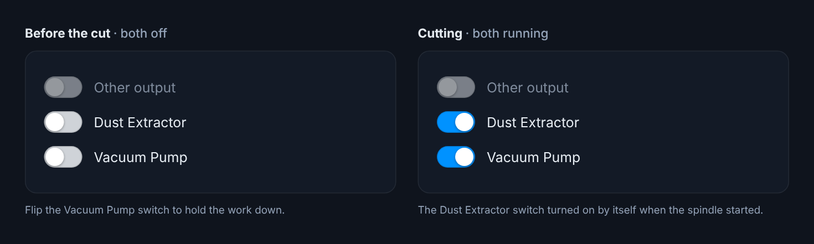
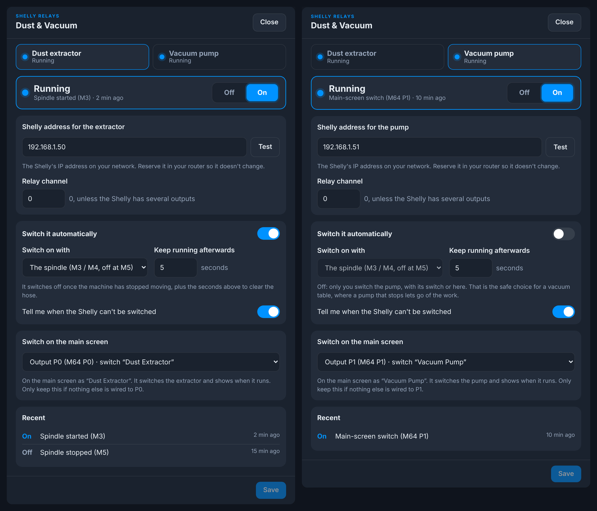

# Shelly Dust & Vacuum for ncSender

**Version 0.3.2** · [Download the latest release](https://github.com/Gedas-dev/ncsender-plugin-shelly-dust-vacuum/releases/latest)

A plugin for [ncSender](https://github.com/siganberg/ncSender) that switches two
machines through Shelly relays on your network: the **dust extractor** and the
**vacuum pump**. Each has its own Shelly, its own settings and, if you want,
its own switch on ncSender's main screen. Written for the Shelly 1 Gen3 and
Shelly 1 Mini Gen3; any Gen2 or newer Shelly with a relay output uses the same
local API and should work.

**Status:** new. The switching logic is covered by automated tests against a
simulated ncSender and simulated Shellys; reports from real machines are welcome
in [Issues](https://github.com/Gedas-dev/ncsender-plugin-shelly-dust-vacuum/issues).

| | Dust extractor | Vacuum pump |
|---|---|---|
| Switched automatically | Yes: on at M3 / M4, off a few seconds after the spindle stops | No, unless you turn it on |
| Switched by hand | Main-screen switch, or the plugin window | Main-screen switch, or the plugin window |

The vacuum pump is by hand only out of the box because it holds the work down:
a pump that stops at a spindle stop, an alarm or a stopped job lets go of the
work. With "Switch it automatically" off, nothing but you ever switches it off.

No cloud, no Home Assistant: ncSender talks straight to each Shelly over HTTP
(`/rpc/Switch.Set`). Use only one of the two if you like: a device with no
address is left alone.

## What you need

- ncSender **2.0.225 or newer** (the first version that lets plugins use the
  network).
- Each Shelly on the same network as the computer or kiosk that runs ncSender,
  with a fixed IP address (reserve it in your router).
- **Authentication switched off** on each Shelly (it is off out of the box).
  The plugin can't sign in to a password-protected device.

## Install

1. Download the plugin zip from the [latest release](https://github.com/Gedas-dev/ncsender-plugin-shelly-dust-vacuum/releases/latest).
   In ncSender open **Settings → Plugins → Install Plugin** and choose it. Do
   not unzip it. It installs over an earlier version and keeps your settings.
2. Open **Dust & Vacuum** from the plugins menu (or Settings → Plugins →
   Shelly Dust & Vacuum → Settings).
3. On each tab, type that Shelly's IP address, press **Test** (it should answer
   with the device's name), then **Save**.
4. Press **On** and **Off** on each tab to check the wiring before you trust it
   with a job.

## Switches on the main screen

ncSender's main-screen switches are controller outputs (Settings → Auxiliary
I/O). The plugin can use one spare output per device as a marker:

1. In the plugin window, on a device's tab, pick a spare output under **Switch
   on the main screen** (for example P0 for the dust extractor, P1 for the
   vacuum pump) and **Save**. Outputs that another plugin uses, such as a tool
   clamp, can't be picked, and the two devices can't share one.
2. In ncSender: **Settings → Auxiliary I/O → Add Output**, give it a name and
   choose the same output (*M64 P0*, *M64 P1*). Leave Hold and Auto Off off.

From then on:

- Flipping a switch switches that device at once, also while a job runs.
- When a device is switched any other way (the spindle, the window, the Shelly
  app), the plugin sends `M64 Pn` / `M65 Pn` itself so its switch shows it.
- A program can use `M64 Pn` / `M65 Pn` to switch a device too.

Worth knowing:

- **Use outputs with nothing wired to them.** The plugin turns them on by
  itself. An output is only a marker; the Shelly does the switching.
- The plugin only sends its `M64` / `M65` while the controller is idle, running
  or jogging. During an alarm or a pause a switch can be behind for a moment;
  the device itself is not.

## How automatic switching decides

| | |
|---|---|
| **On** | As soon as the start code is on its way to the controller. |
| **Off** | After the stop code has been sent **and** the machine has stopped moving, plus the "keep running" seconds. Also when a job is stopped, on an alarm, a reset, or when the controller disconnects. |

Why wait for the machine to stop: ncSender sends a program ahead of the cut, so
the M5 at the end goes by while the last moves are still being made. Switching
off at that moment would cut the final passes without extraction.

Other things worth knowing:

- An M3 that follows an M5 before the device has switched off (a quick tool
  change) keeps it running.
- A job that ends with the spindle still on (no M5 / M30) leaves it on too.
- In laser mode the spindle trigger does nothing (M3 / M4 fire the laser), and
  a check-mode run doesn't start anything.
- A switch made elsewhere (the Shelly app, a wall switch on the SW input) shows
  up within a few seconds. The plugin doesn't fight it.
- If a Shelly doesn't answer, ncSender retries for a minute or two and shows a
  notice once, naming the device. The job is **not** paused.

## Settings (per device)

| Setting | What it does | Default |
|---|---|---|
| Shelly address | IP address or host name of that Shelly | (empty) |
| Relay channel | Which output to switch; 0 on a single-relay Shelly | 0 |
| Switch it automatically | Off: only you switch it | On for the dust extractor, off for the vacuum pump |
| Switch on with | Spindle, flood coolant, mist coolant, or every job | Spindle |
| Keep running afterwards | Seconds to keep running after the machine has stopped | 5 |
| Tell me when the Shelly can't be switched | Shows a notice when switching fails | On |
| Switch on the main screen | The spare controller output that stands for the device | No switch |

Saving does not reload the plugin, so it is safe to change a setting while
something is running. One two-channel Shelly can serve both devices: give them
the same address and different relay channels.

## Wiring and safety

- Check each Shelly's current rating against what it switches; the Mini models
  are rated lower than the Shelly 1. Motors draw several times their running
  current when they start. For anything but a small load, let the Shelly switch
  a contactor (or the machine's own remote-start input) and let the contactor
  switch the motor.
- Mains wiring is for someone qualified to do it.
- As a backstop for a crashed or powered-off ncSender, the dust extractor's
  Shelly can have **Auto OFF** set in its own settings to something longer than
  your longest job. Don't do that on the vacuum pump's Shelly.

## Limits

- Gen1 Shelly devices (the original Shelly 1 / 1PM) have a different API and are
  not supported.
- Password-protected Shellies are not supported.
- The plugin sees codes that ncSender sends. A spindle started some other way
  (a button on the VFD, a macro stored on the controller) is not noticed.
- If the plugin is enabled but fails to load, ncSender won't start a job or a
  tool change, as for every plugin that reads the command stream. Disable it in
  Settings → Plugins to carry on without it.

## Development

| | |
|---|---|
| `plugin/manifest.json` | Name, version, permissions (`network`), menu entry |
| `plugin/commands.js` | Runs inside ncSender: watches commands, talks to the Shellys |
| `plugin/config.html` | The plugin window |
| `tests/commands.test.cjs` | The logic, run against a fake ncSender and fake Shellys |

Run the tests with `node tests/commands.test.cjs` (Node 18 or newer, no
dependencies).

To release: bump `version` in `plugin/manifest.json`, edit `latest_release.md`
and push to `main`. The workflow runs the tests and publishes release
`v<version>` with the plugin zip attached.

`plugin/commands.js` never calls `pluginContext.log()`: it crashes the packaged
ncSender app. The workflow refuses a build that does.

## License

[GPL-3.0](LICENSE)
