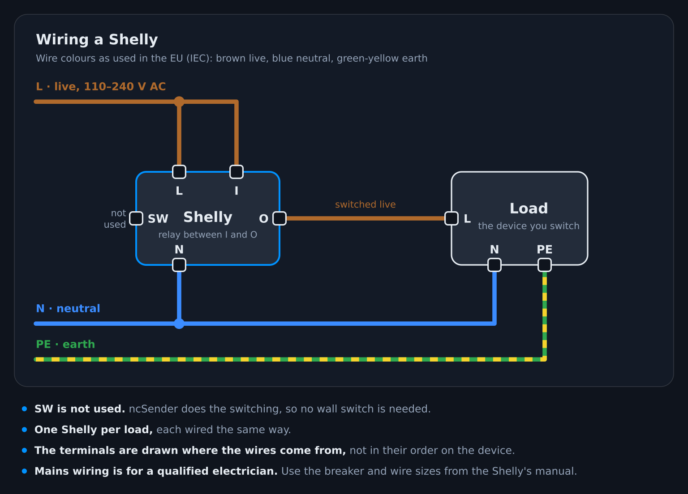

### Shelly Dust & Vacuum for ncSender

**Version 0.3.2** · [Download the latest release](https://github.com/Gedas-dev/ncsender-plugin-shelly-dust-vacuum/releases/latest)

An [ncSender](https://github.com/siganberg/ncSender) plugin that switches a **dust extractor** and a **vacuum pump** through Shelly relays (Gen2 or newer) on your network. No cloud, no Home Assistant.

- **Dust extractor:** on when the spindle starts, off a few seconds after the machine stops.
- **Vacuum pump:** only you switch it, so it never lets go of the work on its own.
- **Main-screen switch** for each, which also shows when it runs.

#### Install

1. Download the zip from the [latest release](https://github.com/Gedas-dev/ncsender-plugin-shelly-dust-vacuum/releases/latest). In ncSender open **Settings → Plugins → Install Plugin** and choose it. Do not unzip it.
2. Open **Dust & Vacuum**. On each tab type that Shelly's IP address, press **Test**, then **Save**.
3. Press **On** and **Off** on each tab to check the wiring.

#### Main-screen switches

1. In the plugin window, pick a spare controller output for each device (for example P0 and P1) and **Save**.
2. In ncSender open **Settings → Auxiliary I/O → Add Output**, name it, and choose the same output (*M64 P0*, *M64 P1*).

Use outputs with nothing wired to them: the plugin turns them on by itself.

#### Wiring

Each Shelly is wired the same way. No wall switch is needed: the SW terminal stays empty.

#### Good to know

- Needs ncSender 2.0.225 or newer.
- Authentication must be off on the Shelly (it is off out of the box).
- For a motor, let the Shelly switch a contactor, not the motor itself.
- Tested on the author's machine with real Shelly relays, and by automated tests against a simulated ncSender. Reports from other machines are welcome in [Issues](https://github.com/Gedas-dev/ncsender-plugin-shelly-dust-vacuum/issues).

#### License

[GPL-3.0](LICENSE)
